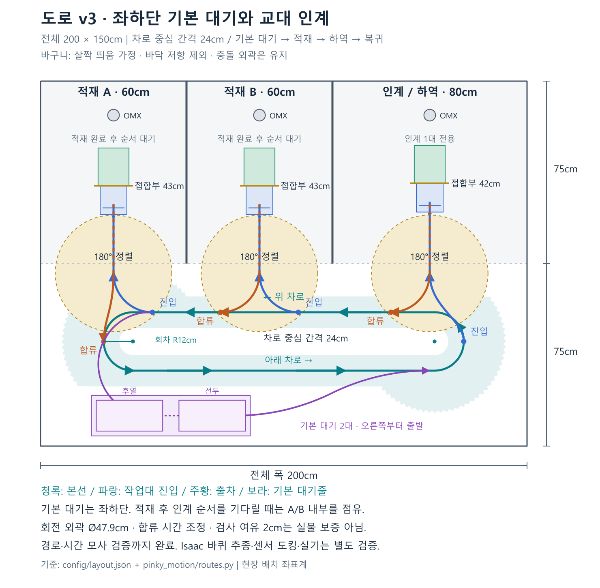

# 도로 설계와 관제 통합의 경계

2026-10-22. **도로와 로봇의 움직임은 이 저장소에서 설계·검증하고, 검증된 도로를 사용하는 권한과 주문 실행은 기존 관제에 통합한다.** 관제 화면에서 별도의 도로를 다시 만들지 않는다. 도로 설정의 버전을 공유하며, 화면은 그 설정과 실제 점유 상태를 표시한다.

## 현재 어디까지 했나

| 항목 | 현재 상태 |
|---|---|
| 200×150cm 배치, A/B/인계 폭 60/60/80cm | 설정 반영 |
| 75cm 공용통로의 방향별 두 차로 | 아래쪽 →, 위쪽 ← 순환로 후보 작성 |
| 양 끝 회차와 바구니 외곽 | v3 차로 간격 24cm·회차 중심 반경 12cm. 구간 사이 바구니 외곽과 각 2cm 확장 검사 통과 |
| 작업대별 진입·정렬·도킹·출차·합류 | v3에서 축소된 회차에 다시 연결. 작업대 쌍 6개와 기본 대기 관련 10개 경로 검사 통과 |
| 교차·회전·출차 예약과 FIFO | 전체 미래 경로 시간 조정과 합성 이탈 관측으로 두 대 교대 인계 모사 통과. 실제 주행 미연결 |
| 대기 장소와 출차 공간 확보 | 좌하단 앞차 우선 기본 대기줄. 적재 후 인계 순서 대기는 A/B 내부. 본선·복귀·출발 외곽 검사 통과 |
| 두 대의 전체 주문 운행 / 정밀주차 | 기본 대기→각 1개 적재 작업대→교대 인계→복귀 기준 모사 완료. 실제 주문·정밀주차·물리 추종 미완료 |
| 기존 관제 명령 왕복 통합 | 미완료 |

[검증 기록과 재현](ROUTE_VALIDATION.md), [두 대 재생](figures/route-plan-v2-20261022/replay.html), [SVG 원본](figures/route-plan-v2-20261022/route-plan.svg), [생성 코드](../tools/draw_route_plan.py). [이전 미완성 그림](figures/route-plan-20261022/route-plan.png)은 이력으로 남긴다.

파랑은 작업대 진입, 주황은 출차·순방향 합류, 보라는 기본 대기줄이다. 옅은 로봇·바구니 사각형은 목표 외곽이다. 마지막 도킹 목은 진입·출차가 공유하므로 한 대씩 허가한다. v3의 경로는 기하·운동학 모사용이며 물리 추종 검증을 마친 실행 경로가 아니다. 사용자 지정 링크를 유지하기 위해 파일 폴더 이름은 v2로 남아 있다.

회전 범위는 위쪽 차로와 겹친다. **차로와 진출입 방향을 나누는 것만으로 충돌 방지가 끝나지 않는다.** 바구니까지 차지하는 회전·합류 영역을 예약하고 전체 미래 경로도 확인한다. 기본 대기는 좌하단에 두지만 적재 후 인계 순서 대기는 A/B 적재 구역을 점유한다. 대기줄은 뒤차가 독립적으로 출발할 수 없는 FIFO 구조다.

v2에서는 B/인계 출차를 위쪽 서향 차로로 합류시키고 A 출차를 왼쪽 회차에 연결하여 아래쪽 차로를 가로지르던 연결을 제거했다. 인계 진입은 오른쪽 회차에서 분기한다. 모델의 평면 경로와 제자리 회전은 검사했지만, Isaac 바퀴 추종·제동 오차를 포함한 물리 검사는 다음 단계다.

## 어디에서 무엇을 완성하나

| 일 | 여기서 개발·검증 | 최종 관제에서 담당 |
|---|---|---|
| 도로 | 방향, 곡선, 정렬/진출입, 회전 범위, 대기 위치, 충돌 구역 | 동일 버전 도로를 화면에 표시하고 운행에 사용 |
| 이동 | 경로 추종, 후진 정렬, 정지·취소, 바구니 정차/이탈 관측 | 목적지와 작업 명령 요청, 결과·관측 수신 |
| 교통 | 자원 묶음, 순서·대기·이탈 해제·통신 불명 정책을 시뮬에서 시험 | **한 곳의 권한**으로 예약 실행, 상태 저장·재시작 복구·운영 표시 |
| 업무 | 기존 업무 계약과 이동 어댑터를 맞춤 | 주문·상품·고객 배정·적재/하역·팔 작업 연계 유지 |

교통 로직은 여기서 검증한 모듈을 관제 백엔드가 사용하거나 단일 교통 서비스로 호출하는 형태로 옮긴다. 관제의 작업대 점유와 별도 이동 서비스가 각각 독립적으로 진입을 허가하는 구조는 피한다. 로봇 구동 명령의 소유권도 한 실행부에서 관리한다.

`route-proposal.json`은 현재 내부 설계 형식이다. Nav2 Route Server용 완성 그래프나 실제 배포된 기능으로 부르지 않는다. 설치 버전의 지원 여부와 실행 연결은 별도 확인 단계다.

## 통합 시점과 완료 기준

전체 개발을 끝낸 뒤 한꺼번에 합치지 않는다. **이동 명령 한 개의 요청·취소·결과 왕복은 초기에 관제와 연결**하고, 나머지 도로·교통 시험은 여기서 계속한다. 기존 관제 저장소 변경 범위는 별도 승인 대상이다.

최종 도로·교통 기능을 넘기는 기준은 다음과 같다.

1. 모든 필요한 A/B/인계 왕복에 진입·후진·출차·합류 궤적이 연결되고, 바구니 외곽과 정지 여유를 포함해 공간을 벗어나지 않는다. 직선 차로 간격만 검사하지 않는다.
2. 두 대가 동시에 인계를 요청하면 한 대만 진입한다. 두 번째 로봇의 대기 위치가 첫 번째 로봇의 출구를 막지 않고, 바구니 완전 이탈 확인 후 다음 진입을 허가한다. A/B와 인계 사이 이동도 포함한다.
3. 경로 추종 중 지연·취소·통신 불명·오래된 관측에서 멈추고 점유를 보존한다. 실패와 재개 순서가 기록된다. 단순 타임아웃을 이탈로 취급하지 않는다.
4. 관제 어댑터에 목적지/도로 버전/로봇·명령·실행 식별자, 정밀 정차 및 구역 이탈의 별도 근거가 전달된다. simulation 출처를 실물 관측으로 위장하지 않는다.

이 단계의 합격은 시뮬 기준이다. 실기 정확도와 팔 작업 성공은 후속 전이 시험의 결과로 따로 기록한다. 현재 네 가지 기준은 모두 완료된 상태가 아니다.

## 바구니 모델 변경

사용자는 바닥 저항이 현실에서 거의 없으므로 시뮬에서 조금 떠 있는 것으로 취급하도록 지시했다. 기본값에 가시적인 간격 5mm를 두고, 바구니 충돌 형상과 바닥 사이의 접촉만 제외했다. **5mm는 실측 높이가 아니라 표현용 가정이다.** 바구니 질량·관성과 벽·물건·다른 로봇에 대한 충돌 형상, 평면 외곽은 유지한다.

[smoke-005-raised-basket](../outputs/smoke-005-raised-basket/run.json)는 바구니 포함 전후진·회전·정지·높이·렌더 검사를 통과했다. 명목 57.30° 회전 구간의 응답은 56.56°였다. ROS 연결이나 도로 추종, 두 대 충돌 검증을 수행한 시험은 아니다. 이전 접촉·마찰 비교는 이력으로 보존하며, 추가 마찰 조사는 도로 개발의 선행 조건으로 두지 않는다.
